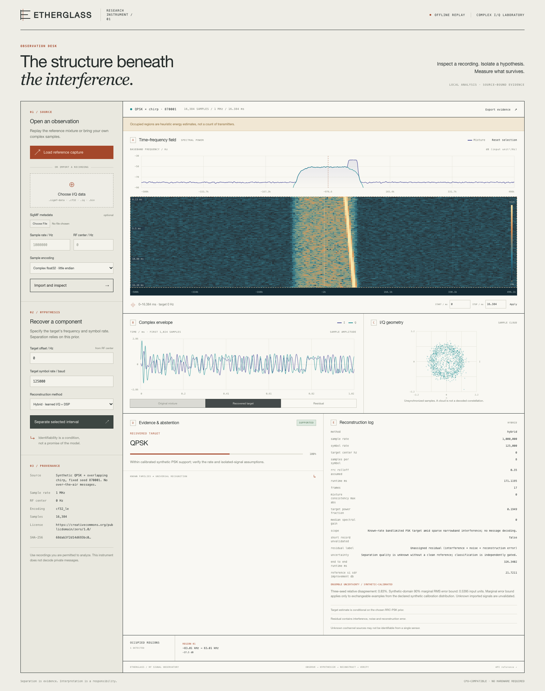
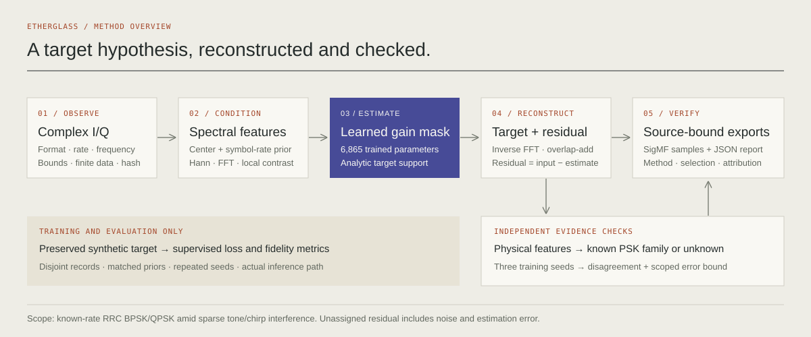
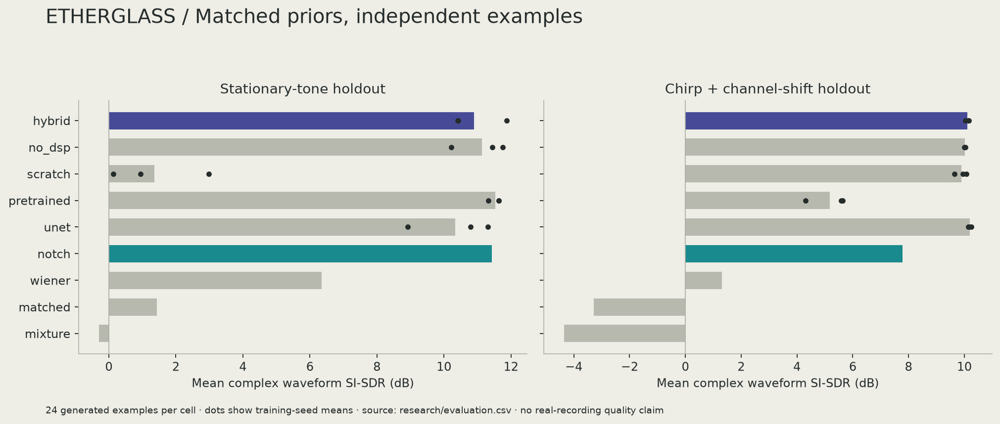
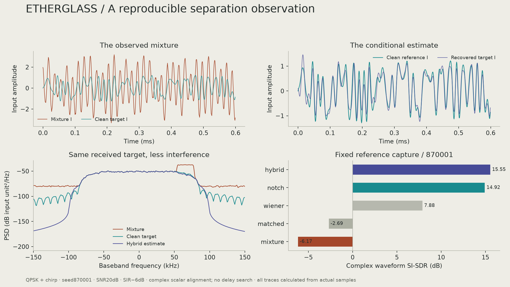

<p align="center"><strong>E T H E R G L A S S</strong><br>RF Signal Observatory</p>

# The structure beneath the interference.

An offline research instrument for complex I/Q recordings: inspect the spectrum,
test a target hypothesis, reconstruct a component, and export the evidence.
Its compact trained model combines complex spectral features, classical signal
priors, and interference-aware learning. Every trace is calculated from its input.



**A specific research result, a useful instrument, and visible limits.** This first
release extracts a known-rate root-raised-cosine BPSK/QPSK target amid overlapping
tones or chirps. It provides a target estimate and an unassigned residual, with
classical/neural comparisons, separate unknown-signal abstention, and reproducible
experiments. Arbitrary cochannel sources are not uniquely recoverable from a
single sensor; the stress tests include that failure case.

## Run it on a CPU

```sh
git clone https://github.com/nazeeh111/ETHERGLASS.git
cd ETHERGLASS
python3.12 -m venv .venv
source .venv/bin/activate
pip install -e '.[test]'
pytest
etherglass serve
```

Open the loopback URL printed in the terminal. If a port is occupied,
`etherglass serve --port 0` selects a free port. On Linux, install CPU PyTorch
first if desired: `pip install torch==2.9.1 --index-url https://download.pytorch.org/whl/cpu`.
No radio hardware, GPU, account, model API, or training run is needed for replay.
The trained weights are included.

[Watch the 20-second measured demonstration](https://github.com/nazeeh111/ETHERGLASS/releases/download/v0.1.0/launch.mp4).

Load the reference capture, leave its explicit 0 Hz target offset and 125 kbaud
rate prior, and separate. Change the displayed trace to compare the mixture,
target, and residual. Drag the waterfall or use numeric controls to inspect a
selection. Export complex samples, SigMF metadata, and the source-bound report.

```sh
etherglass demo --output reference-run
etherglass analyze examples/reference/mixture.sigmf-data --symbol-rate 125000 \
  --method hybrid --output analysis-run
```

[Complete tutorial and formats](docs/QUICKSTART.md) · [Scientific protocol](research/PROTOCOL.md)
· [Research foundations](docs/FOUNDATIONS.md) · [Data and licenses](docs/DATA_LICENSES.md)

## What the instrument measures

- Synchronized Welch spectrum, bounded-frame waterfall, complex I/Q waveform,
  and raw sample geometry. Time/frequency selection operates on actual samples.
- Heuristic occupied-region detection and input diagnostics, with explicit
  sample-rate, frequency, encoding, checksum, and recording provenance.
- Prior-conditioned reconstruction with a 6,865-parameter dilated spectral model,
  an analytic support constraint, and overlap-add synthesis.
- Matched filtering, bandpass, robust spectral Wiener, adaptive notch, and a
  27,121-parameter spectral U-Net comparator. All receive the same target priors.
- Calibrated BPSK/QPSK recognition with an independent support gate. A missing
  prior, short record, insufficient support, or uncertain class returns unknown.
- Reconstructed complex I/Q, SigMF 1.2.6, and quantitative JSON exports.
  Multi-tune inputs are analyzed one tuning segment at a time.

Raw I/Q density is not a symbol-synchronized constellation. An occupied region
is not an identified transmitter. A confident family label does not prove that
a component was correctly separated. The residual includes interference, noise,
and reconstruction error.

## A falsifiable experiment



**Hypothesis:** with the same 160-update adaptation budget, stationary-tone
pretraining improves held-out chirp/channel-shift reconstruction relative to
training the identical network from scratch. A separate contrast-feature
ablation tests whether explicit multiscale spectral structure contributes.
Pretraining adds data and compute; it is not a free improvement.

The study uses disjoint generated records, three training seeds, matched target
priors, exact public inference, controlled SNR/SIR/channel sweeps, and a separate
TorchSig-generator holdout. It retains per-example measurements, training logs,
configurations, checkpoints, and alignment conventions. The U-Net is a locally
implemented spectral comparator, not a claim to reproduce the RF Challenge
paper's architecture or scores.

The completed study contains **432 generated records across 18 conditions and 8,640
per-method measurements**. On the 24-record chirp/channel-shift holdout:

| Method | Mean target SI-SDR / dB | Trained parameters |
|---|---:|---:|
| Adaptive notch | 7.79 | 0 |
| Small spectral U-Net | 10.19 | 27,121 |
| ETHERGLASS hybrid | 10.11 | 6,865 |

The hybrid improves over adaptive notch by **2.32 dB** (paired-example 95% bootstrap
interval 1.70–3.03 dB), with about 75% fewer parameters than the U-Net. Its mean score
is slightly below the U-Net's; superiority over that neural comparator is not
established. Adaptive notch performs better on the nominal stationary-tone set.

Adaptation adds 4.94 dB over the pretrained model on shifted inputs. Pretraining
adds only 0.22 dB over adaptation from scratch, and the contrast-feature ablation
does not establish a clear gain. Fully overlapping digital sources remain
unrecovered. These outcomes are retained alongside the positive result.





The figure above is one fixed, unselected reference observation, not an aggregate
benchmark. [Raw experiment evidence](research/) distinguishes development checks,
controlled final holdouts, adaptation effects, symbol-fidelity assumptions,
and out-of-domain failures. [Model and scientific report](docs/MODEL_CARD.md)
provides the release conclusions.

## Reproduce and challenge it

```sh
pip install -e '.[research,test]'
python scripts/verify_artifacts.py
python research/run_experiment.py train --seeds 0,1,2
python research/run_experiment.py evaluate --seeds 0,1,2 --count 24
python scripts/train_classifier.py
python scripts/calibrate_uncertainty.py
python scripts/evaluate_external.py
python scripts/make_figures.py
```

Training is optional, local, and CPU compatible. It can take tens of minutes or
longer depending on hardware. Run reproduction in a copy to preserve the released
artifacts; training intentionally writes new model/evidence files. For a small
development run use `--quick` with training and then evaluate its saved config.
Do not present quick-run results as the released full-budget study.

The 40-window **RadioPile ITS** excerpt is CC-BY-4.0 hybrid over-the-air data with
added AWGN. Its 500-sample records test actual-input replay and short-record
abstention, not learned unknown-rejection accuracy. A separate continuous
**CAMRAS Danuri** excerpt tests numerical stability and conditional abstention.
Neither has clean target truth or establishes real-world separation quality.
No real recording is used to train or choose thresholds. Source/session/device
independence is not asserted where identifiers do not establish it.

## Reusable analysis

```python
from etherglass.io import load_capture, iter_iq_blocks
from etherglass.separation import separate

capture = load_capture("examples/reference/mixture.sigmf-data")
result = separate(capture.samples, capture.sample_rate,
                  target_center=0, symbol_rate=125000, method="hybrid")
target, residual = result["components"]
assert len(target) == len(capture.samples)
```

The interactive app accepts up to 64 MiB per capture and keeps four captures in
memory. `iter_iq_blocks` provides bounded file iteration for larger recordings.
The separator uses overlapping 2,048-sample frames. Live SDR acquisition and
hardware performance are not implemented or claimed in v0.1.0.

## Provenance and release

Original code and synthetic-only trained weights are MIT. Original generated
recordings and clean references are CC0. The attributed TorchSig helper remains
MIT and real recordings retain their individual CC-BY terms. See [licenses and
attribution](docs/DATA_LICENSES.md). GNU Radio and the RF Challenge are research
references; this project does not copy their GPL implementation or claim their
published performance. Editable figures use local vectors and measured data.

Use recordings you are permitted to analyze. ETHERGLASS has no transmitter,
private-message recovery, or universal signal decoder. Its intended uses are
reproducible interference research, signal inspection, and honest RFML teaching.

[Versioned releases](https://github.com/nazeeh111/ETHERGLASS/releases)
· [Contributing](CONTRIBUTING.md) · [MIT license](LICENSE)
