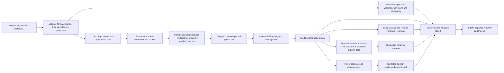

# From a recording to a defensible estimate

The clean target appears only in supervised training and reference evaluation.
It is not an input to inference. The bundled reference demonstration permits
visibly labelled quality measurements. A user recording has no hidden reference
and receives no invented SI-SDR, EVM, or bit-error score.

## Numerical path

`io.py` decodes explicitly described interleaved samples, normalizes integer
formats, preserves floating amplitude and source metadata, and rejects unsupported
layouts. SHA-256 binds a report to input bytes. SigMF export includes a newly
calculated SHA-512 of the exported samples.

`dsp.py` computes Welch PSD in input-unit²/Hz and a bounded-frame Hann waterfall.
The sample cloud is unsynchronized. Waveforms show contiguous samples, avoiding
alias artifacts from arbitrary display decimation. Occupancy is a declared
energy heuristic rather than a calibrated detection probability.

`models.py` maps seven mixture-only spectral channels to a support-constrained
gain. `separation.py` handles downmixing, frame overlap and synthesis. The model
does not emit a bitstream. Its nonnegative spectral gain cannot recover missing
phase information or uniquely identify two arbitrary cochannel sources.

`classification.py` analyzes the first 2,048 samples with the same policy used
for calibration. Known-class probability is conditional on synthetic BPSK/QPSK
support. A separate support score and class threshold control abstention. A
residual is not passed off as a classified transmitter.

`uncertainty.py` compares three independent training seeds. Its waveform error
bound is split-calibrated on a separate synthetic population. Shared model bias
can give low disagreement on wrong estimates; real unknown recordings do not
inherit a coverage guarantee.

## Shared interfaces

The CLI and FastAPI app call the same `analysis.analyze` function. Plot arrays
are bounded views; full reconstructions remain available for export. Selection
bounds are absolute source sample indices, while chart time coordinates are local
to the selected interval. Selections cannot cross SigMF retuning boundaries.

The app binds to loopback and keeps a bounded in-memory store. No remote model
calls, accounts, telemetry code, transmissions, or private-message recovery are
implemented. Imported metadata paths are never followed. A file iterator provides
bounded reads for large recordings; live acquisition is outside v0.1.0.

## Artifact flow

The experiment runner records configuration, logs and checkpoint hashes;
evaluates the exact public inference path; and emits raw CSV/JSON. Figure scripts
read those measured outputs. The reference mixture has a fixed seed chosen before
its score was observed. Wheel resources copy released checkpoint bytes exactly.
`ARTIFACTS.json` binds source, evidence, recordings, weights and media to a version.
